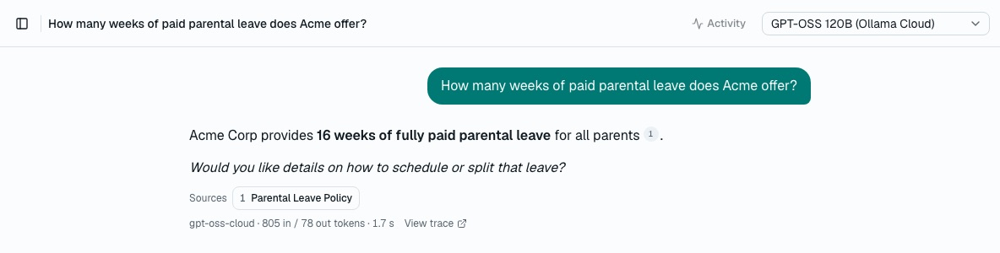
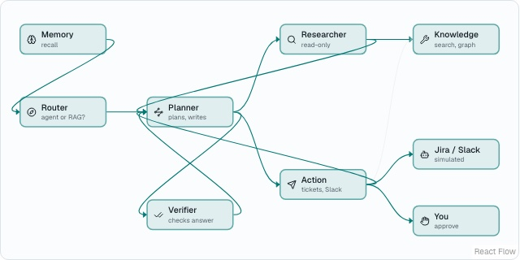
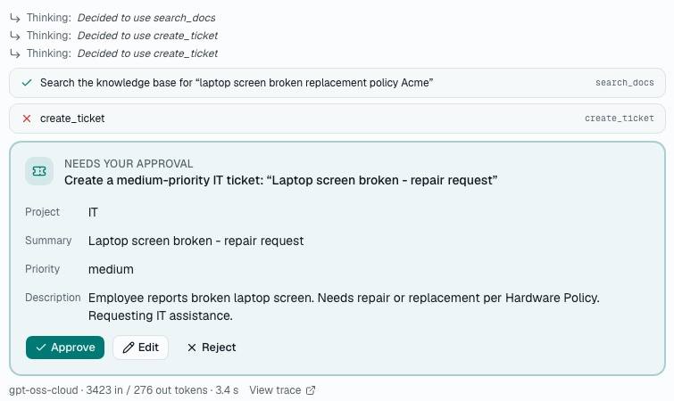
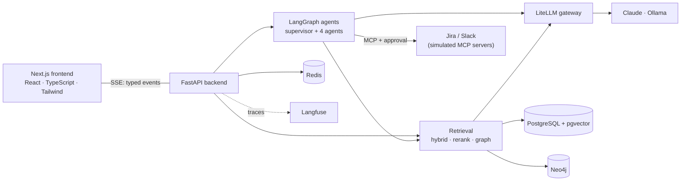

# Atlas — AI Knowledge Assistant + Action Agent

Atlas is a full-stack AI application where employees ask questions about company knowledge and get
**cited answers**, and a **team of AI agents** takes actions for them — like opening a Jira ticket or
posting in Slack — **only after a human approves**. Every retrieval, agent step and tool call streams
live to the UI.

**Stack:** Next.js · React · TypeScript · Tailwind · FastAPI · LangGraph · LiteLLM · PostgreSQL + pgvector ·
Neo4j · Redis · MCP · Langfuse · Docker Compose

<p align="center">
  
</p>

## Highlights

- **RAG with citations.** Hybrid search (pgvector + Postgres full-text, fused with Reciprocal Rank Fusion),
  a cross-encoder reranker, query rewriting for follow-ups, and GraphRAG over a Neo4j knowledge graph.
  Every answer links to the passages it used.
- **Multi-agent team with human approval.** A LangGraph supervisor routes work to a planner, a
  read-only researcher, an action agent and a verifier. Any tool that writes to an external system
  pauses for an approval card the user can approve, edit or reject.
- **MCP both ways.** Jira and Slack are reached through MCP servers (simulated locally), and Atlas
  itself is exposed as a read-only MCP server that Claude Desktop can use.
- **Live, typed streaming.** The backend streams typed events (`token`, `citation`, `agent_step`,
  `tool_call`, `approval_request`, `error`, `done`) over Server-Sent Events. The frontend renders them
  as they arrive, including an animated agent graph built with React Flow.
- **Multimodal and voice.** Ask questions about images, search scanned PDFs and charts, dictate with a
  local Whisper model, and have answers read aloud.
- **Guardrails and access control.** Prompt-injection quarantine at ingestion, PII masking before
  anything is stored or sent, an output check for unexpected links, session login, per-user chats and
  memory, permission-aware retrieval, and Redis rate limits.
- **Evals and observability from day one.** Every feature has an eval, every model call is traced in
  Langfuse, and CI fails the build if retrieval quality drops below a gate.
- **Model-agnostic.** All LLM calls go through a LiteLLM gateway, so Claude, Ollama Cloud models or local
  models are a config change, not a code change.

<table>
  <tr>
    <td width="50%"></td>
    <td width="50%"></td>
  </tr>
  <tr>
    <td align="center">The agent team, live in the UI</td>
    <td align="center">A write action waiting for human approval</td>
  </tr>
</table>

## Results

Measured with the eval suite in [`backend/evals/`](backend/evals/) on a golden set of questions with known
answers and sources.

| What | Result |
| --- | --- |
| Retrieval hit rate (vector only → hybrid + rewrite) | 89% → **96%** |
| Retrieval MRR | 0.81 → **0.87** |
| Answer faithfulness (LLM judge) | 88% → **94%** |
| Follow-up question correctness (query rewriting) | 42% → **83%** |
| Agent routing accuracy | **100%** |
| Write actions taken without approval | **0** |
| Scanned PDF + chart questions: right source found | **100%** |
| Speech-to-text word error rate (local Whisper) | **3.8%** |
| Permission leaks (5 questions × 3 users with different roles) | **0** |
| Backend tests | 179 |

The reasoning behind each choice, and what was tried and rejected, is in the
[decision log](docs/decisions.md).

## Architecture



| Layer | Tech |
| --- | --- |
| Frontend | Next.js (App Router), React, TypeScript, Tailwind CSS, shadcn/ui, Framer Motion, React Flow, Recharts |
| Backend | FastAPI, Pydantic v2, SQLAlchemy + Alembic |
| AI | LangGraph, LiteLLM, sentence-transformers (embeddings + reranker), Whisper, Presidio, official MCP SDK |
| Data | PostgreSQL + pgvector (app data, chats, memory, vectors, eval results), Neo4j, Redis |
| Observability and evals | Langfuse (self-hosted), RAGAS-style metrics, LLM-as-judge |
| Infra | Docker Compose (11 services), GitHub Actions |

## Run it locally

**You need:** Docker Desktop (Compose v2+), and an API key for at least one model provider
(Anthropic, or Ollama Cloud). [uv](https://docs.astral.sh/uv/) and Node.js 20+ are only needed to run
tests or the frontend outside Docker.

```bash
git clone <this repo> atlas && cd atlas
cp .env.example .env
# edit .env: set your model API key and replace every "change-me" / "replace" value
# (generate secrets with: openssl rand -hex 32)

docker compose up -d                                   # start everything
docker compose ps                                      # all services should show "healthy"
docker compose exec backend python -m ingestion.run    # load data/ into the knowledge base
docker compose exec backend python -m scripts.seed_users   # create the demo logins (config/auth.yaml)
```

| Service | URL |
| --- | --- |
| Web app | http://localhost:3000 |
| Backend API docs | http://localhost:8000/docs |
| Langfuse traces | http://localhost:3001 |
| Neo4j browser | http://localhost:7474 |

Chat models are listed in [`config/models.yaml`](config/models.yaml); prompts are versioned YAML in
[`prompts/`](prompts/).

## Tests and evals

```bash
cd backend && uv run pytest                                   # backend tests (fake LLM, test database)
cd frontend && npm run lint && npx tsc --noEmit               # frontend lint + type check
docker compose exec backend python -m evals.run --retrieval-only   # retrieval evals, no model calls
docker compose exec backend python -m evals.run               # full evals with an LLM judge
docker compose exec backend python -m evals.agent_run         # routing, actions, approval gate
docker compose exec backend python -m evals.guardrails_run    # injection, PII, permissions
```

## Data

The knowledge base combines 35 pages of the public [GitLab handbook](https://handbook.gitlab.com)
(CC BY-SA 4.0) with a synthetic corpus for **Acme Corp**, a fictional company, written so every eval
question has exactly one known answer and source. See [`data/README.md`](data/README.md).

## Repository layout

```
frontend/   Next.js app                 backend/   FastAPI, agents, retrieval, evals, MCP servers
prompts/    versioned prompt YAML       config/    models, RAG, agents, guardrails, auth
data/       knowledge-base documents    infra/     database init scripts
docs/       plan, phase walkthroughs, decision log, MCP setup
```

## Roadmap

- Semantic cache, routing between cheap and strong models, and a cost dashboard
- Deployment configuration
- Fully local mode with Ollama, and a LoRA fine-tuned model

## How it was built

Atlas was built phase by phase as a hands-on project in modern AI engineering, with Claude Code as
an AI pair programmer. Each phase has a walkthrough in [`docs/walkthroughs/`](docs/walkthroughs/)
explaining how a request flows through the system and why each design choice was made.

## License

[MIT](LICENSE). The GitLab handbook content in `data/gitlab/` remains under CC BY-SA 4.0.
