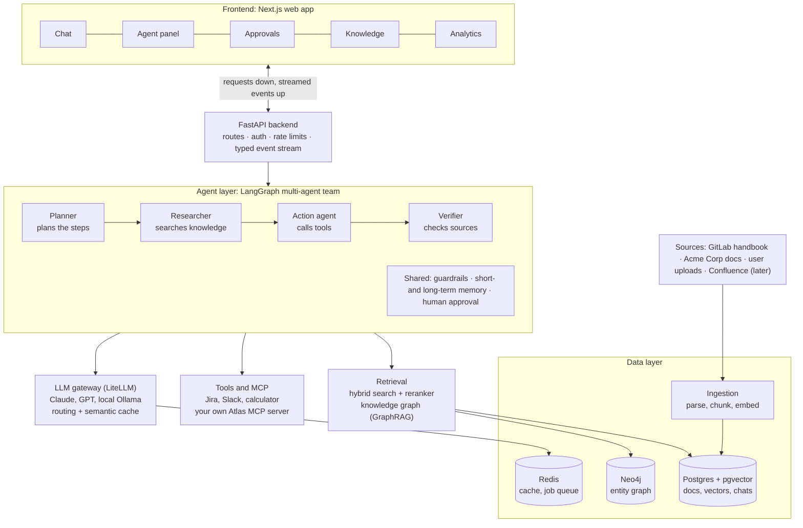
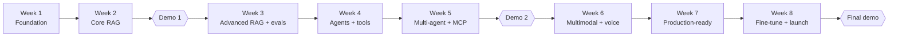

# Project Plan: Atlas — AI Knowledge Assistant + Action Agent

## Vision

Build **"Atlas"**, a polished web app where employees chat with company knowledge and an AI agent team takes actions for them, with every reasoning step visible on screen. The working name is a placeholder; rename it anytime.

**Who it's for:** any employee who wastes time searching wikis, asking colleagues, or doing repetitive follow-up work.

**What it does, in one demo:**

1. A user asks: "What's our policy on parental leave, and can you open a ticket for HR to confirm my dates?"
2. Atlas searches the knowledge base, answers with clickable source citations, and shows a live panel of agents working (Planner, Researcher, Action Agent, Verifier).
3. Before creating the Jira ticket, it pauses and asks the user to approve.
4. The ticket is created, a Slack summary is posted, and an analytics dashboard updates cost, latency, and answer-quality scores.

**Primary goal:** learn every major area of modern AI engineering by building it for real. **Secondary goal:** a production-style reference project that shows the whole system working end to end.

**Data stance:** the project runs fully on public and fictional data (GitLab's public handbook plus a generated fictional company, "Acme Corp"). Internal company data is an optional plug-in later, never a dependency.

**How it's built:** Claude Code writes most of the code, one phase per week (about 8 weeks). The developer learns through a fixed loop each phase: review the plan, read the walkthrough, get quizzed, write 2–3 changes personally, and debug an injected bug. See `CLAUDE.md`.

## Guiding principles

Rework happens when a later feature forces you to change an early decision, so these eight decisions are locked in on day one, even if some are only used in later phases.

1. **Final architecture from day one.** Separate frontend and backend from the start (Next.js + FastAPI). Later phases add modules; they never restructure the app.
2. **Model-agnostic LLM gateway.** All model calls go through one wrapper (LiteLLM), so switching between Claude, GPT, Gemini, or a local Ollama model is a config change, not a code change.
3. **Interfaces before implementations.** Data sources, retrievers, tools, and agents each follow a fixed interface. A new data source (e.g., Confluence) or tool is a new file, not edits across the codebase.
4. **Streaming events contract.** The backend streams typed events (token, tool_call, agent_step, citation, approval_request, done) from Phase 1. The UI's agent panel, citations, and approvals all consume this same stream, so nothing is rewired later.
5. **Postgres + pgvector as the single database.** App data, chat history, memory, eval results, and vectors live in one Postgres instance. No migration from a toy vector store later.
6. **Observability and evals from week one.** Tracing (Langfuse) and a test-question set are added in Phase 1, so every improvement is measurable and you never retrofit logging.
7. **Docker Compose for everything.** One command starts the whole stack locally, and the same setup deploys to the cloud.
8. **Config-driven behaviour.** Prompts, model names, chunk sizes, and feature flags live in config files and a prompt registry, never hard-coded.

## AI concepts coverage map

The project covers 24 modern AI engineering topics across 8 phases; each row is something you will build, not just read about.

| AI topic | What you build in Atlas | Phase |
| --- | --- | --- |
| LLM fundamentals (tokens, context, temperature) | Basic chat with model switching | 1 |
| LLM API integration and streaming | Token-by-token streamed responses in the UI | 1 |
| Prompt engineering and prompt versioning | System prompts in a versioned prompt registry | 1 |
| Structured outputs (JSON schemas) | Pydantic-validated outputs for classification and tool inputs | 1 |
| Embeddings | Embedding pipeline for all documents | 2 |
| Vector databases | pgvector index with metadata filters | 2 |
| RAG (retrieval-augmented generation) | Answers grounded in documents with citations | 2 |
| Document parsing and chunking | PDF, HTML, Markdown ingestion with chunking strategies | 2 |
| Advanced RAG (hybrid search, reranking, query rewriting) | Keyword + semantic search, reranker, multi-query | 3 |
| GraphRAG / knowledge graphs | Entity graph of people, teams, and policies | 3 |
| Evaluation (RAG metrics, LLM-as-judge) | Eval suite with dashboards and regression checks | 3 |
| Tool calling / function calling | Search, ticket, Slack, calculator tools | 4 |
| Agentic AI (agent loop, planning) | Single ReAct-style agent with LangGraph | 4 |
| Human-in-the-loop | Approval cards before any write action | 4 |
| Memory (short-term and long-term) | Conversation memory and user preference memory | 4 |
| Multi-agent systems | Planner, Researcher, Action, Verifier agents | 5 |
| MCP (Model Context Protocol) | Consume Jira/Slack MCP servers and publish your own Atlas MCP server | 5 |
| Agent-to-agent (A2A) patterns | Supervisor and handoff patterns between agents | 5 |
| Multimodal AI | Questions about images, screenshots, charts, and scanned PDFs | 6 |
| Voice AI | Speech-to-text input and text-to-speech replies | 6 |
| Guardrails and AI safety | Prompt-injection defence, PII masking, output filtering | 7 |
| Observability / LLMOps | Traces, cost and latency per request | 7 |
| Cost and latency optimisation | Semantic caching, model routing (cheap vs smart model) | 7 |
| Local and open-source models + fine-tuning | Ollama models; a small LoRA fine-tune for ticket classification | 8 |

The last row is optional depth: fine-tuning is worth understanding, but most real products rely on RAG and prompting, so it comes last.

## System architecture

Atlas is six layers stacked top to bottom, and each later phase fills in a box rather than adding a new layer.



Across all layers: Langfuse tracing · evals in CI · cost and latency dashboards.

A question travels down from the UI to the agent team, which calls retrieval, tools, and models; every step streams back up so the UI can show it live. New data sources only touch the bottom two layers.

## Tech stack

Python does the AI work; a modern React frontend does the selling. Every tool below has a free tier or is open source.

| Layer | Choice | Why this one |
| --- | --- | --- |
| Frontend | Next.js (React) + TypeScript + Tailwind CSS + shadcn/ui | Looks professional, industry standard, huge job market value |
| Frontend AI helpers | Vercel AI SDK (UI hooks) | Ready-made streaming chat components |
| Animations and graphs | Framer Motion, React Flow, Recharts | Animated agent graph, smooth UI, dashboards |
| Backend API | FastAPI (Python) | Async, fast, streams Server-Sent Events, auto API docs |
| Agent orchestration | LangGraph | Industry favourite for stateful, multi-agent workflows with human-in-the-loop |
| LLM gateway | LiteLLM | One interface for Claude, GPT, Gemini, and local models |
| LLMs | Claude (main), a cheaper small model for routing, Ollama for local | Learn model routing and trade-offs |
| Embeddings and reranking | Open-source embeddings (e.g., BGE via sentence-transformers) or an API embedding model; a cross-encoder reranker | Compare cost vs quality |
| Database + vectors | PostgreSQL + pgvector | One database for everything (principle 5) |
| Cache and queue | Redis | Semantic cache, background ingestion jobs |
| Document parsing | Unstructured or Docling | PDFs, tables, HTML, images |
| Knowledge graph | Neo4j (Phase 3) | GraphRAG experiments |
| MCP | Official MCP Python SDK; Atlassian and Slack MCP servers | Consume and publish MCP |
| Evaluation | RAGAS + custom LLM-as-judge + pytest | Measurable quality |
| Observability | Langfuse (self-hosted, open source) | Traces, prompts, costs |
| Guardrails | Presidio (PII), custom injection checks, optionally NeMo Guardrails | Safety layer |
| Voice | Whisper (speech-to-text) + a TTS API | Voice mode |
| Auth | NextAuth (Auth.js) | Multiple users, per-user memory |
| DevOps | Docker Compose, GitHub Actions, deploy to Vercel (frontend) + Railway/Render/Fly.io (backend) | Live public demo link |

If React is new to you, Phase 1 includes a short ramp-up; your Python strength covers everything else. Pin library versions in Phase 1 because AI libraries change quickly.

## UI plan

Jo dikhta hai wo bikta hai: Atlas has six screens plus inline approval cards, and the star feature is a live panel that shows the AI agents thinking and acting in real time. Viewers remember that far more than any console output.

| Screen | What it shows | Eye-catching features | Phase |
| --- | --- | --- | --- |
| Chat | Main conversation | Streaming answers, clickable citation chips that open the source passage, suggested follow-up questions | 1–2 |
| Agent Activity Panel | Side panel next to chat | Animated graph of agents (React Flow) lighting up as they work, tool calls with inputs and outputs, step timeline | 4–5 |
| Approval cards | Inline in chat | "Create Jira ticket?" preview card with Approve / Edit / Reject buttons | 4 |
| Knowledge Base | Document library | Drag-and-drop upload, live ingestion progress, chunk viewer, a 2D "embedding map" of documents clustered by topic | 2–3 |
| Knowledge Graph Explorer | Interactive graph | Zoomable graph of teams, people, policies, and their links | 3 |
| Analytics Dashboard | Ops and quality metrics | Cost per query, latency, token usage, eval scores over time, thumbs up/down feedback | 3, 7 |
| Settings / Playground | Configuration | Model picker, temperature slider, side-by-side model comparison, prompt version switcher | 1, 7 |

**Polish details that make it feel like a product:** dark and light mode, mobile-friendly layout, keyboard shortcuts, loading skeletons, a voice button with a waveform animation (Phase 6), and an onboarding tour for first-time visitors.

**Design rule:** build the app shell (sidebar, navigation, all six empty pages) in Phase 1. Each later phase fills in a page rather than redesigning the layout.

## Repository structure and core interfaces

One monorepo, created in full in Phase 1, so every later feature has a home waiting for it.

```
atlas/
├── frontend/                 # Next.js app
│   ├── app/                  # pages: chat, knowledge, graph, analytics, settings
│   ├── components/           # chat, agent-panel, approval-card, charts
│   └── lib/events.ts         # typed streaming events (mirrors backend)
├── backend/
│   ├── api/                  # FastAPI routes (chat, ingest, evals, admin)
│   ├── core/                 # config, LLM gateway, prompt registry, events
│   ├── ingestion/
│   │   ├── sources/          # gitlab_handbook.py, acme_docs.py, confluence.py (later)
│   │   ├── parsers/          # pdf, html, markdown, image
│   │   └── chunkers/         # fixed, recursive, semantic
│   ├── retrieval/            # vector, keyword, hybrid, reranker, graph
│   ├── agents/               # graph definitions, planner, researcher, action, verifier
│   ├── tools/                # search_docs, create_ticket, post_slack, calculator
│   ├── mcp/                  # MCP clients + Atlas MCP server
│   ├── memory/               # short-term and long-term memory
│   ├── guardrails/           # injection, PII, output checks
│   └── evals/                # datasets, metrics, runners
├── data/                     # sample docs, synthetic Acme Corp corpus
├── prompts/                  # versioned prompt files (YAML)
├── infra/                    # docker-compose, deploy configs
├── docs/                     # PLAN.md, walkthroughs, decision log
└── .github/workflows/        # CI: tests + evals
```

**The five interfaces that prevent rework** (Python abstract classes defined in Phase 1):

| Interface | Key method | Implementations added over time |
| --- | --- | --- |
| `DataSource` | `load() -> list[Document]` | GitLab handbook, Acme Corp, uploads, Confluence |
| `Retriever` | `retrieve(query, filters) -> list[Chunk]` | Vector, keyword, hybrid, graph |
| `Tool` | `run(input) -> ToolResult` + JSON schema | Search, Jira, Slack, calculator, MCP-backed tools |
| `Agent` | node in a LangGraph graph | Single agent, then Planner / Researcher / Action / Verifier |
| `StreamEvent` | typed event sent to the UI | token, citation, agent_step, tool_call, approval_request, error, done |

## Phased roadmap

The build takes about **8 weeks, one phase per week**, with Claude Code writing most of the code and the developer completing the learning loop for each phase. Every phase ends with something you can show on screen. Phases 6 and 8 are optional depth; skipping them breaks nothing.



Each phase fills in boxes from the architecture above, so nothing built earlier is thrown away.

| Phase | You build | You learn | Done when |
| --- | --- | --- | --- |
| 1. Foundation | Monorepo, Docker Compose, FastAPI, Next.js app shell with all pages, LiteLLM gateway, streaming chat, prompt registry, Langfuse, first 20 eval questions | LLM basics, streaming, prompt engineering, structured outputs, React basics | Chat streams answers in the UI; you can switch models; every call shows in Langfuse |
| 2. Core RAG | GitLab handbook and Acme Corp loaders, parsers, chunking, embeddings, pgvector, citation chips, Knowledge Base page with upload | Embeddings, vector search, chunking, RAG | Answers cite the right source for 80% of the eval questions |
| 3. Advanced RAG + evals | Hybrid search, reranker, query rewriting, metadata filters, GraphRAG with Neo4j, RAGAS eval suite in CI, embedding map, analytics v1 | Advanced retrieval, knowledge graphs, evaluation | A measurable jump in retrieval scores over Phase 2; evals run on every pull request |
| 4. Agents + tools | LangGraph agent, tools (search, ticket, Slack, calculator), approval cards, short- and long-term memory, agent step timeline | Tool calling, agent loops, human-in-the-loop, memory | The agent completes "answer and open a ticket" with approval, end to end |
| 5. Multi-agent + MCP | Planner, Researcher, Action, Verifier agents; Jira and Slack via MCP; your own Atlas MCP server; animated agent graph | Multi-agent design, supervisor and handoff patterns, MCP | Agents hand off visibly in the UI; Atlas works as an MCP server from Claude Desktop |
| 6. Multimodal + voice | Image and scanned-PDF questions, chart understanding, speech-to-text and text-to-speech | Vision models, voice AI | You can ask a question by voice about a screenshot |
| 7. Production-ready | Guardrails (injection, PII), permission-aware retrieval, semantic cache, model routing, auth, cost dashboard, cloud deployment | AI safety, LLMOps, cost and latency optimisation | Live public link with login; a poisoned document is blocked in the demo |
| 8. Fine-tune + launch | Ollama local mode, small LoRA fine-tune for ticket classification compared against prompting, demo video, README, blog post | Open-source models, fine-tuning trade-offs | Final demo recorded and project published |

A phase counts as done only when its "Done when" criteria are met, the walkthrough doc exists, and the quiz and personal exercises are complete. If a phase takes longer than a week, let it; understanding matters more than the calendar.

## Evaluation, observability, and safety

These three are what separate a toy demo from production-grade AI.

**Evaluation (starts Phase 1, grows every phase)**

- A golden dataset of 50 questions with expected answers and expected source documents, grown to 150 by Phase 7. Use the fictional Acme Corp docs, where you know the true answers.
- Retrieval metrics: hit rate and MRR (did the right document come back, and how high).
- Answer metrics with RAGAS: faithfulness (no made-up facts), answer relevance, context precision.
- Agent metrics: task success rate, correct tool chosen, number of steps, cost per task.
- LLM-as-judge for open-ended quality, spot-checked by you against human judgement.
- Evals run automatically in GitHub Actions on every pull request; a drop in score fails the build.

**Observability**

- Every request is traced in Langfuse: prompts, retrieved chunks, tool calls, tokens, cost, latency.
- User feedback (thumbs up/down) is attached to traces, so bad answers become new eval cases.
- The Analytics Dashboard surfaces these numbers in the UI.

**Safety and guardrails**

- Prompt-injection defence: documents are treated as data, never instructions; a classifier flags suspicious content. Include a "poisoned" test document to prove it works in demos.
- PII detection and masking with Presidio before data reaches the model or logs.
- Permission-aware retrieval: documents carry access tags, and users only retrieve what they're allowed to see.
- Human approval for every write action (tickets, messages).
- Rate limits and per-user cost caps.

## Deployment and cost

The whole project can run for roughly the cost of a few coffees a month, because most tools are open source and model usage during development is small.

**Local development:** `docker compose up` starts Postgres, Redis, Langfuse, the backend, and the frontend. Ollama lets you develop offline with zero API cost.

**Public demo:** frontend on Vercel (free tier), backend and database on Railway, Render, or Fly.io (free or low-cost tiers). A live link lets anyone try Atlas without installing anything.

**Keeping costs low:**

- Use a small, cheap model for routing, classification, and evals; use the strongest model only for final answers.
- Turn on semantic caching so repeated questions cost nothing.
- Set a monthly spending limit on every API key.
- Run open-source embeddings locally instead of paying per call.
- Protect the public demo with login and a daily query limit per user.

Check current free-tier limits and model prices when you start, since they change often.

## Showcase kit

Show progress at milestones: a demo after Phase 2, Phase 5, and Phase 8, rather than waiting for a finished product.

- A 5-minute live demo script: ask a policy question, show citations, trigger a ticket with approval, open the agent panel and the dashboard.
- A strong README: demo GIF, architecture diagram, feature list, eval results, and setup in one command.
- A 2–3 minute demo video and, once deployed, a live demo link.
- A decision log in `docs/` explaining choices (e.g., "why pgvector over Pinecone").
- One short story per topic using problem → what you tried → result with a number, e.g., "hybrid search plus reranking raised retrieval hit rate from 72% to 89%." Use real numbers.
- Optionally, a few blog posts along the way ("What I learned building a multi-agent system").

- [ ] Demo after Phase 2
- [ ] Demo after Phase 5
- [ ] Final demo after Phase 8
- [ ] README, video, and live link ready

## Risks

The biggest risk is not technical: it's scope creep and losing momentum, so every phase ends with something demoable.

| Risk | How the plan handles it |
| --- | --- |
| Scope too big, motivation drops | Every phase ships a visible, working feature; phases 6 and 8 can be skipped without breaking anything |
| Internal data isn't available | Public + fictional data by design; internal data is just another `DataSource` |
| AI libraries change or break | Pinned versions, LiteLLM gateway, thin wrappers around frameworks |
| React learning curve slows you down | shadcn/ui components and Vercel AI SDK give ready-made pieces; ask Claude Code to explain React patterns as it builds |
| Reading code without really understanding it | The learning loop: quiz, personal exercises, and break-and-fix every phase |
| API costs grow | Local models, caching, spending limits, cheap-model routing |
| Agents behave unpredictably | Evals, tracing, step limits, and human approval for write actions |
| Demo fails live | Recorded backup video and a seeded demo dataset with tested questions |
